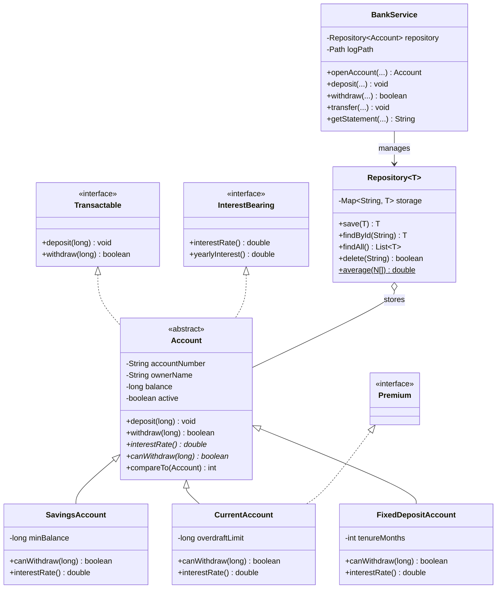

# MiniBank — Java Console Banking Application

### Student Identification & Academic Details
- **Student Name:** Hetvi Sangani
- **Enrollment Number:** 25CE105
- **Subject:** Object-Oriented Programming
- **Subject Code:** CEUE203
- **Semester:** 3
- **Academic Year:** 2026-27
- **Institution:** Faculty of Technology and Engineering (FTE), Charotar University of Science and Technology (CHARUSAT)
- **Language:** Java 17+
- **Repository Naming Pattern:** `oop-minibank-25CE105`

---

## Overview

MiniBank is a multi-milestone console banking application designed to progressively demonstrate core and advanced concepts in Object-Oriented Programming in Java. The project evolves across 14 practicals from basic syntax and encapsulation to multithreading, concurrency control, NIO persistence, the Collections Framework, Generics, and complete service-layer architecture with unit testing.

---

## Lab 01 — MiniBank Setup and Menu Shell

### Implemented Features:
1. **Application Header Record**: `BankInfo(String name, String branch)` to represent immutable bank metadata.
2. **Menu Options Enum**: `MenuOption` defining available actions (`OPEN_ACCOUNT`, `DEPOSIT`, `WITHDRAW`, `TRANSFER`, `WORKING_HOURS`, `EXIT`).
3. **Switch Expression**: Modern Java 17+ pattern switch expression returning placeholders and response strings for selected menu options.
4. **Interactive Scanner Loop**: Interactive menu with numeric validation and graceful loop termination upon selecting `EXIT`.
5. **Maven Build System**: Standard `pom.xml` configured for Java 17+ and JUnit 5.

---

## Lab 02 — Encapsulation: Customer and Account Models

### Implemented Features:
1. **Customer Model**: Encapsulated customer state with auto-generated unique ID (`CUST101`, `CUST102`), private fields (`name`, `email`, `mobile`), and public getters.
2. **Account Model**:
   - `accountNumber`: Generated via static counter formatted as `AC0001`, `AC0002` (immutable `final`).
   - Private fields: `ownerName`, `balance` in whole rupees, and `active` boolean status.
   - Dual constructors: `Account(ownerName, balance)` and `Account(ownerName)` chained to `this(ownerName, 0)`.
   - Business methods: `deposit(amount)` and `withdraw(amount)` with boundary validation (rejecting negative/zero amounts and overdrawing without balance).
   - Strict encapsulation: No public setter for balance.
3. **Execution Verification**: Instantiated three accounts in an array, processed deposits and withdrawals, and verified final balances.

---

## Lab 03 — Object Methods, Nested Address Class, and Cloneable

### Implemented Features:
1. **Readable Representation (`toString()`)**: Overrode `toString()` in `Account` and `Customer` for structured, human-readable logging.
2. **Object Equality (`equals()` & `hashCode()`)**: Overrode `equals()` and `hashCode()` in `Account` keyed strictly by `accountNumber` to satisfy the Java equality contract for collections.
3. **Static Nested Class (`Customer.Address`)**: Encapsulated address details (`line`, `city`, `pincode`) as a clean static nested class within `Customer`.
4. **Object Cloning (`Cloneable`)**: Implemented deep copy cloning in `Customer` and `Customer.Address` via `clone()`.
5. **Type Checking**: Demonstrated modern Java pattern matching with `instanceof`.

---

## Lab 04 — Input Validation, Command Parsing, and Statement Formatting

### Implemented Features:
1. **Regular Expression Validation (`Validator`)**: Pre-compiled regex patterns checking:
   - Mobile numbers (`^[6-9][0-9]{9}$`)
   - RFC-compliant Email addresses
   - Indian Permanent Account Number (PAN) (`^[A-Z]{5}[0-9]{4}[A-Z]$`)
   - Indian Financial System Code (IFSC) (`^[A-Z]{4}0[A-Z0-9]{6}$`)
   - Positive numeric amounts
2. **Transaction Modeling**:
   - `TransactionType` enum (`DEPOSIT`, `WITHDRAW`, `TRANSFER`).
   - `Command` record encapsulating `type`, `accountNumber`, and `amount`.
3. **Command Parsing (`CommandParser`)**: String-splitting parser turning console commands like `"DEPOSIT AC0001 500"` into typed `Command` objects with defensive 3-token format validation.
4. **Statement Assembly (`StatementFormatter`)**: Efficient multi-line account statement generation using `StringBuilder`.

---

## Lab 05 — Abstract Classes, Inheritance, and Dynamic Polymorphism

### Implemented Features:
1. **Abstract Base Class (`Account`)**: Made `Account` abstract with two polymorphic contract methods:
   - `public abstract double interestRate();`
   - `public abstract boolean canWithdraw(long amount);`
2. **Subclasses with Specialized Rules**:
   - `SavingsAccount`: 4.0% interest rate, enforces minimum balance (`minBalance`).
   - `CurrentAccount`: 0.0% interest rate, supports overdraft credit facility down to `-overdraftLimit`.
   - `FixedDepositAccount`: 7.0% interest rate, withdrawals locked (`canWithdraw` returns `false`).
3. **Super Constructor Chaining**: All subclasses invoke `super(ownerName, balance)` to cleanly initialize inherited state.
4. **Polymorphic Execution**: Heterogeneous `Account[]` array evaluated at runtime with automatic dynamic method dispatch and pattern matching `instanceof`.

---

## Lab 06 — Interfaces, Functional Interfaces, Lambdas, and Package Architecture

### Implemented Features:
1. **Behavioral Interfaces**:
   - `Transactable`: Defines `deposit(amount)` and `withdraw(amount)`. Implemented by `Account`.
   - `InterestBearing`: Provides abstract `interestRate()` and default implementation `yearlyInterest()` computing annualized interest.
2. **Functional Interface & Lambda Demonstration**:
   - `WithdrawRule`: `@FunctionalInterface` specifying `boolean allow(Account account, long amount)`.
   - Evaluated using both an **anonymous inner class** (VIP rule) and a **lambda expression** (daily transaction cap).
3. **Marker Interface (`Premium`)**: Defines a zero-method tagging interface implemented by high-tier corporate accounts (`CurrentAccount`).
4. **Package Organization**:
   - `model`: Core domain entities (`Account`, `SavingsAccount`, `CurrentAccount`, `FixedDepositAccount`, `Customer`, interfaces).
   - `util`: Validation regex, parsers, formatters, and command records.
   - `service`: Business and transactional logic layer.
5. **Static Import**: Integrated `import static util.Validator.*;` for clean, direct validation invocation.
6. **Executable JAR**: Maven configured to package the entire application into a standalone runnable JAR (`java -jar target/Sem-3-MiniBank-1.0.0.jar`).

---

## Lab 07 — Custom Annotations and Reflection-Based Validation

### Implemented Features:
1. **Custom Annotations (`model.annotation`)**:
   - `@Id`: Runtime marker annotation on `accountNumber` indicating entity identity.
   - `@Positive`: Numeric field constraint with default message `"must be > 0"` placed on `Account.balance`.
   - `@MaxLength`: Member-valued constraint `int value()` placed on `Account.ownerName`.
2. **Reflection-Based Validator (`AnnotationValidator`)**:
   - Evaluates object fields reflectively across subclass and superclass hierarchies using `field.setAccessible(true)`.
   - Checks presence of `@Positive` and verifies numerical limits.
   - Checks presence of `@MaxLength` and validates string lengths.
3. **Execution Verification**:
   - Valid account returns an empty error array (`[]`).
   - Isolated negative-balance test case (-100) triggers `@Positive` validation, yielding `["must be > 0"]`.

---

## Lab 08 — Custom Exception Hierarchy, Safe Transfers, and Resource Management

### Implemented Features:
1. **Custom Checked Exception Hierarchy (`exception`)**:
   - `BankException`: Base checked exception extending `java.lang.Exception`.
   - `InsufficientFundsException`: Extends `BankException`, encapsulates exact `shortfall` amount.
   - `AccountNotFoundException`: Extends `BankException` for non-existent target accounts.
   - `InvalidAmountException`: Extends `BankException` for non-positive or negative amounts.
2. **Defensive Contract Updates**:
   - `Account.withdraw(amount)` declares `throws InsufficientFundsException, InvalidAmountException`.
   - `Account.deposit(amount)` declares `throws InvalidAmountException`.
3. **Transactional Safe Transfer (`transfer`)**:
   - Atomic multi-step operation with `try-catch-finally`.
   - Guarantees rollback if destination deposit fails.
   - Re-throws checked `BankException` for higher-level handling.
4. **Automated Resource Management (`AutoCloseable`)**:
   - Created `BankingSession implements AutoCloseable`.
   - Demonstrated `try-with-resources` ensuring deterministic closure even under failure conditions.

---

## Lab 09 — Multithreading, Race Condition Analysis, and Synchronization

### Implemented Features:
1. **Worker Threads (`AccountWorker`)**: Implemented `Runnable` executing repetitive banking transactions (`times`, `amount`).
2. **Race Condition Demonstration**:
   - Simulated 10 concurrent threads updating an un-synchronized shared account.
   - Demonstrated non-deterministic lost updates caused by preemptive thread scheduling and unsynchronized read-modify-write cycles.
3. **Thread Synchronization**:
   - Synchronized `Account.deposit` and `Account.withdraw` methods (locking on the account instance monitor).
   - Verified that 10 concurrent threads depositing ₹10 across 100 iterations result in an exact, deterministic balance of ₹10,000 every single run.
4. **Thread Lifecycle Inspection**: Named threads (`SafeWorker-N`), printed active worker names, and coordinated termination via `thread.join()`.

---

## Lab 10 — High-Concurrency Processing, Producer-Consumer, and Deadlock Avoidance

### Implemented Features:
1. **Thread Pool Executor (`TransactionProcessor`)**:
   - Manages an internal `ExecutorService` backed by `Executors.newFixedThreadPool(4)`.
   - Supports non-blocking task submission via `submit(Runnable)` and clean lifecycle termination via `stop()` (`shutdown()` and `awaitTermination()`).
2. **Inter-Thread Coordination (`TransactionBuffer`)**:
   - Bounded array buffer modeling a producer-consumer processing pipeline.
   - Leverages Java monitor primitives `wait()` and `notifyAll()` inside synchronized methods to eliminate polling and race conditions.
3. **Deadlock Analysis & Prevention (`SafeTransferService`)**:
   - Analyzed how concurrent bidirectional transfers (A -> B and B -> A) produce deadlock under unordered lock acquisition.
   - Solved circular wait by imposing a deterministic **global lock ordering** based on alphanumeric `accountNumber` comparison (`compareTo`), ensuring deadlock-free multi-resource locking.

---

## Lab 11 — File Handling, NIO.2 & Object Serialization

### Implemented Features:
1. **Binary Object Serialization (`StatePersister`)**:
   - Persists account object arrays using `ObjectOutputStream` inside try-with-resources.
   - Deserializes and restores accounts with `ObjectInputStream`.
   - Automatically synchronizes internal static ID counter (`Account.synchronizeCounter`) upon loading state to prevent ID collisions with newly created accounts.
2. **NIO.2 Append Logging (`TransactionLog`)**:
   - Uses `java.nio.file.Files.write` with `StandardOpenOption.CREATE` and `StandardOpenOption.APPEND` for thread-safe, non-destructive audit append operations.
   - Automatically provisions parent directories with `Files.createDirectories`.
3. **Audit Report Aggregation (`ReportGenerator`)**:
   - Employs `DirectoryStream<Path>` to efficiently walk log directories without loading all file descriptors into memory.
   - Reads file attributes (`BasicFileAttributes`) for timestamp and size metadata.
   - Aggregates transaction flows (deposits vs. withdrawals) line-by-line via `BufferedReader` and exports structured audit reports to disk.

---

## Lab 12 — Java Collections Framework & Thread-Safe Storage

### Implemented Features:
1. **Centralized In-Memory Store (`AccountStore`)**:
   - Manages accounts using `HashMap<String, Account>` keyed by unique `accountNumber` providing $O(1)$ lookups.
   - Retains chronological transaction audit histories in `ArrayList<String>`.
2. **Natural Ordering via `Comparable`**:
   - `model.Account` implements `Comparable<Account>` comparing alphanumeric account identifiers (`compareTo`).
   - `AccountStore.sortedNatural()` sorts collection using natural key ordering via `Collections.sort()`.
3. **Custom Ordering via `Comparator`**:
   - `AccountStore.sortedByBalance()` executes custom comparator logic sorting accounts in descending balance order.
   - `AccountStore.sortedByOwnerName()` demonstrates lambda-based case-insensitive name sorting.
4. **Thread-Safe Concurrent Map (`ConcurrentHashMap`)**:
   - Integrates `ConcurrentHashMap<String, Account>` for non-blocking concurrent reads and segmented thread-safe writes across worker threads without `ConcurrentModificationException`.

---

## Lab 13 — Generic Repository Pattern & Bounded Type Parameters

### Implemented Features:
1. **Generic Type-Safe Repository (`Repository<T>`)**:
   - Manages generic entity persistence backed by `Map<String, T>`.
   - Performs automated primary key discovery using Java reflection to traverse class hierarchies for fields annotated with `@Id`.
   - Implements full CRUD lifecycle: `save(T)`, `@SafeVarargs saveAll(T...)`, `findById(String)`, `findAll()`, `delete(String)`, and `count()`.
2. **Bounded Generic Methods**:
   - Static method `Repository.average(N[] values)` bounded by `N extends Number` (`<N extends Number> double average(N[] values)`).
   - Computes precision averages across polymorphic numeric arrays (`Long[]`, `Double[]`, `Integer[]`) via `Number.doubleValue()`.

---

## Lab 14 — Service Layer Integration, JUnit 5 Test Suite & Packaging

### Implemented Features:
1. **Orchestrating Service Layer (`BankService`)**:
   - Injects generic `Repository<Account>` for decoupled, in-memory domain persistence.
   - Coordinates account creation with reflective annotation validation (`AnnotationValidator.validate()`).
   - Implements transactional atomic deposit, withdrawal, and deadlock-free inter-account transfers via `SafeTransferService`.
   - Generates statements using `StatementFormatter` and manages state persistence (`saveAll`/`loadAll`).
2. **Automated JUnit 5 Test Suite (`MiniBankTest`)**:
   - `testDeposit_IncreasesBalance()`: Verifies positive balance increment.
   - `testWithdraw_InsufficientFunds_ThrowsException()`: Asserts exception throwing and correct shortfall computation when exceeding reserve limits.
   - `testInvalidAmountException()`: Validates negative/zero bounds checking.
   - `testConcurrentDeposits_MaintainThreadSafety()`: Asserts 10 threads concurrently depositing ₹1,000 each results in exact ₹10,000 balance without race condition.
   - `testRepository_ReflectiveIdAndCrud()`: Verifies `@Id` reflection, save, findById, findAll, and delete operations.
   - `testBoundedGenericAverage()`: Verifies `<N extends Number> double average(N[] values)` across numeric subtypes.
   - `testValidationConstraints()`: Asserts regex patterns and annotation constraints.
   - `testSafeTransfer_AtomicAndDeadlockFree()`: Asserts conservation of total funds across concurrent bidirectional transfers.
3. **Maven Build & Runnable Uber-JAR**:
   - Configured `maven-jar-plugin` and `maven-surefire-plugin` with `mainClass: MiniBank`.
   - Produces runnable artifact `target/Sem-3-MiniBank-1.0.0.jar`.

---

## 🏛️ Architecture & Domain Model



---

## 📋 14-Lab Traceability Matrix

| Lab Tag | Commit Title | Key Java Concepts | Primary Classes Modified / Created |
| :--- | :--- | :--- | :--- |
| `lab-01` | Set up MiniBank menu and project structure | Records, Enums, Modern Switch, Scanner, Maven | `MiniBank.java`, `pom.xml`, `BankInfo`, `MenuOption` |
| `lab-02` | Add customer and account models | Encapsulation, Private State, ID Generation, `this()` Chaining | `Customer.java`, `Account.java` |
| `lab-03` | Implement object methods and nested address | `toString`, `equals`, `hashCode`, Static Nested Class, `Cloneable`, Pattern Matching | `Customer.Address`, `Customer.clone()`, `Account.equals()` |
| `lab-04` | Add validation and command parsing | Regular Expressions (`Pattern`/`Matcher`), Text Parsing, `StringBuilder` | `Validator.java`, `Command.java`, `StatementFormatter.java` |
| `lab-05` | Implement account inheritance and polymorphism | `abstract` Class, Inheritance, Dynamic Dispatch, `super()` | `SavingsAccount.java`, `CurrentAccount.java`, `FixedDepositAccount.java` |
| `lab-06` | Add interfaces and organize packages | Interfaces, Default Methods, `@FunctionalInterface`, Marker Interface, Static Imports | `Transactable.java`, `InterestBearing.java`, `WithdrawRule.java`, `Premium.java` |
| `lab-07` | Implement annotations and reflection validation | Custom Annotations (`@Retention`, `@Target`), Reflection API | `@Id`, `@Positive`, `@MaxLength`, `AnnotationValidator.java` |
| `lab-08` | Add custom exceptions and safe transfers | Custom Exceptions Hierarchy, `throws`, `try-with-resources`, `AutoCloseable` | `BankException.java`, `InsufficientFundsException.java`, `BankingSession.java` |
| `lab-09` | Implement synchronized account operations | Threads (`Runnable`), Race Condition Demonstration, `synchronized` Methods | `AccountWorker.java`, `Account.deposit()`, `Account.depositUnsynchronized()` |
| `lab-10` | Add transaction processor and concurrency demos | Thread Pools (`ExecutorService`), Producer-Consumer (`wait`/`notifyAll`), Deadlock Prevention | `TransactionProcessor.java`, `TransactionBuffer.java`, `SafeTransferService.java` |
| `lab-11` | Implement persistence and transaction reports | NIO.2 (`Files`, `Path`, `DirectoryStream`), Binary Serialization (`ObjectOutputStream`) | `StatePersister.java`, `TransactionLog.java`, `ReportGenerator.java` |
| `lab-12` | Add collections and thread-safe account storage | Collections Framework (`HashMap`, `ArrayList`), `Comparable`, `Comparator`, `ConcurrentHashMap` | `AccountStore.java`, `Account.compareTo()`, `AccountStore.sortedByBalance()` |
| `lab-13` | Implement generic repository | Generics (`Repository<T>`), Varargs (`@SafeVarargs`), Bounded Generics (`<N extends Number>`) | `Repository.java`, `Repository.average()` |
| `lab-14` | Integrate MiniBank services, tests and packaging | Service Layer Orchestration, JUnit 5 Testing Suite, Maven Packaging | `BankService.java`, `MiniBankTest.java`, Runnable JAR |

---

## 🎯 Viva Examination Cheat Sheet

### 1. Object-Oriented Programming & Design
- **Why did we use Constructor Chaining (`this(...)`) in Account and Customer?**
  - Eliminates code duplication and guarantees invariant checks (e.g. initial balance bounds, ID sequencing) execute uniformly through a central canonical constructor.
- **Why are `accountNumber` and `customerId` immutable (`private final`)?**
  - Account and customer identifiers serve as natural primary keys in hash tables (`HashMap`, `AccountStore`). If mutated after insertion, their hash codes would alter, creating silent memory leaks and making objects unretrievable.
- **What is the difference between Comparable and Comparator?**
  - `Comparable<T>` defines an object's single *natural ordering* (implemented in `Account.java` via `compareTo` by `accountNumber`).
  - `Comparator<T>` defines *external, pluggable orderings* (implemented in `AccountStore.java` to sort by balance descending or owner name alphabetically).

### 2. Concurrency & Multithreading
- **How was the race condition in Practical 09 demonstrated?**
  - Ten concurrent threads performed non-atomic read-modify-write operations (`balance = current + amount`) via `depositUnsynchronized()`. Interleaved thread switches resulted in lost updates. Applying `synchronized` on `deposit()` enforced mutual exclusion, ensuring exact balance consistency.
- **How did we eliminate Deadlock in Practical 10?**
  - Deadlock occurs in circular wait scenarios (e.g., Thread 1 locks A and requests B, while Thread 2 locks B and requests A). We eliminated circular wait by ordering lock acquisitions deterministically according to alphanumeric account numbers (`compareTo`).
- **Why use `wait()` and `notifyAll()` inside a `while` loop in TransactionBuffer?**
  - Guarding wait conditions inside `while` loops prevents **spurious wakeups** and re-evaluates the buffer condition once monitor control is regained.

### 3. Java Reflection & Annotations
- **How does AnnotationValidator discover annotations on private fields?**
  - Traverses the class hierarchy recursively (`getSuperclass()`), inspects `getDeclaredFields()`, checks `isAnnotationPresent()`, and invokes `field.setAccessible(true)` to access encapsulated values.

### 4. IO & NIO.2
- **Why prefer NIO.2 (`DirectoryStream`) over legacy `File.listFiles()`?**
  - `File.listFiles()` loads all filenames into memory simultaneously, causing heap pressure in directories with millions of records. `Files.newDirectoryStream()` iterates lazily via file system cursors.

---

## 🚀 How to Build, Test and Run

### Run Automated JUnit 5 Test Suite:
```bash
mvn clean test
```

### Build Runnable Uber-JAR:
```bash
mvn clean package
```

### Run MiniBank Application:
```bash
java -jar target/Sem-3-MiniBank-1.0.0.jar
```

### Verify Git Commits & Tags:
```bash
git log --oneline --reverse
git tag --list "lab-*"
```
